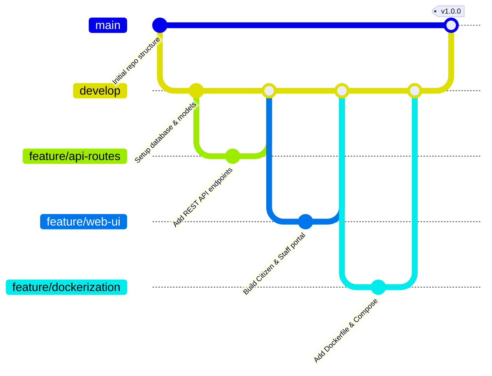

# Municipal Citizen Service Request and Grievance Management Platform (E-Governance)

[]()
[]()
[]()
[]()

> **SIMATS ENGINEERING (Saveetha School of Engineering)**  
> **Department of Computer Science and Engineering**  
> **Student Name:** K. Vijay Bhaskar Reddy  
> **Register Number:** 192425155  
> **Course Code:** CSA10 / CSA1007 / CSA1063 – Software Engineering  

---

## 1. Project Overview
The **Municipal Citizen Service Request and Grievance Management Platform** is a secure, responsive, full-stack E-Governance application engineered to streamline the registration, dispatch, resolution, and citizen auditing of civic issues (road potholes, uncollected solid waste, street lighting failures, sewage overflows, and water contamination).

### Core Objectives
1. **Citizen Empowerment:** Provide a transparent digital channel for submitting geo-referenced civic issues with instant `GRV-2026-XXXXX` tracking ID generation.
2. **Operational Dispatch:** Enable municipal staff to review, prioritize, and assign grievances to ward-level field engineers.
3. **Automated SLA Enforcement:** Calculate automated service-level agreement (SLA) deadlines (High: 24h, Medium: 48h, Low: 72h) and flag nearing or breached tickets.
4. **Citizen Closed-Loop Verification:** Allow citizens to verify resolution quality with 1–5 star ratings or reopen dissatisfied tickets.

---

## 2. Repository Folder Structure

```
municipal-grievance-platform/
├── .github/
│   └── workflows/
│       └── ci-cd.yml          # Automated CI/CD pipeline definition (Lint, Test, Docker Build)
├── backend/                   # Application Tier (Business logic, REST API & Data Access)
│   ├── app.py                 # Flask application factory, routes registration & entry point
│   ├── config.py              # Environment configuration, SLA targets, category constants
│   ├── database.py            # SQLite database schema, connection pooling & context manager
│   ├── models.py              # Payload validation, tracking ID generator, entity models
│   ├── routes.py              # REST API endpoints (intake, tracking, dispatch, feedback, stats)
│   └── sla_engine.py          # SLA calculation engine, breach detector & timeline auditor
├── frontend/                  # Presentation Tier (Responsive Web Portal)
│   ├── index.html             # Multi-tab SPA (Citizen intake, Tracking, Staff triage, Analytics)
│   ├── css/
│   │   └── style.css          # Modern typography, responsive flex/grid layouts & status badges
│   └── js/
│       └── app.js             # Client-side state, asynchronous REST fetch, dynamic DOM rendering
├── tests/                     # Verification Tier (Automated Test Suite)
│   ├── __init__.py
│   ├── test_complaints.py     # Functional endpoint tests, boundary value & lifecycle tests
│   └── test_sla.py            # SLA deadline calculation & breach status unit tests
├── docker/                    # Containerization Orchestration
│   ├── Dockerfile             # Production multi-stage Docker build specification
│   └── docker-compose.yml     # Multi-container orchestration (App, Volumes, Networks)
├── Dockerfile                 # Root multi-stage Dockerfile
├── docker-compose.yml         # Root compose definition
├── .dockerignore              # Excluded files for optimized Docker layer caching
├── .gitignore                 # Version control exclusions (venv, db, caches, logs)
├── .gitattributes             # Line ending normalization and diff rules
├── requirements.txt           # Explicit Python dependencies with pinned versions
├── pytest.ini                 # PyTest test runner configuration
└── README.md                  # Comprehensive technical documentation & setup guide
```

### Folder Justification
* `backend/`: Decouples business rules and database persistence from presentation, enforcing Clean Architecture and Separation of Concerns (SoC).
* `frontend/`: Standalone static client assets that can be served via CDN or web server without tight coupling to the backend runtime.
* `tests/`: Automated unit and integration test suites executed on every Git commit to guarantee regression prevention.
* `.github/workflows/`: Enforces continuous integration, automating quality gates before code enters `main`.

---

## 3. Git Branching Strategy & Workflow

This project adheres to the **Gitflow Branching Model**:



### Branch Taxonomy
* `main`: Protected production branch containing battle-tested, releasable code.
* `develop`: Main integration branch where feature branches merge.
* `feature/<feature-name>`: Ephemeral development branches for distinct user stories (e.g., `feature/complaint-intake`, `feature/sla-engine`).
* `hotfix/<fix-name>`: Urgent patches branched directly from `main`.

### Conventional Commit Standard
All commit messages adhere to semantic versioning guidelines:
* `feat(scope):` New capability (e.g., `feat(api): add status update endpoint`)
* `fix(scope):` Defect remediation (e.g., `fix(models): resolve boundary check for phone numbers`)
* `test(scope):` Automated test additions (e.g., `test(sla): add breach evaluation tests`)
* `docs(scope):` Documentation modifications (e.g., `docs(readme): update setup instructions`)

---

## 4. Local Quickstart (Without Docker)

### Prerequisites
* Python 3.11+
* Git

### Step-by-Step Instructions
```bash
# 1. Clone repository
git clone https://github.com/vjbhaskar19/municipal-grievance-platform.git
cd municipal-grievance-platform

# 2. Install dependencies
pip install -r requirements.txt

# 3. Run automated tests to verify build integrity
python -m pytest

# 4. Launch the application
python -m backend.app
```
Access the application in your browser at: **`http://localhost:8000`**

---

## 5. Container Deployment (Docker & Docker Compose)

The application uses an optimized **Multi-Stage Dockerfile** (`python:3.11-slim`) that isolates build tools in stage 1 and deploys an unprivileged non-root user (`appuser`, UID 1001) in stage 2 for security compliance.

### Using Docker Compose (Recommended)
```bash
# Build and run containers in detached mode
docker compose up -d --build

# Verify running container status and health
docker compose ps

# Inspect real-time container logs
docker compose logs -f

# Stop container cluster
docker compose down
```

### Direct Docker Commands
```bash
# Build container image
docker build -t municipal-grievance-app:latest .

# Run container with volume persistence
docker run -d -p 8000:8000 --name grievance-app municipal-grievance-app:latest

# Check container health status
curl -f http://localhost:8000/api/v1/healthz
```

---

## 6. REST API Reference

| Method | Endpoint | Description | Sample Payload / Params |
| :--- | :--- | :--- | :--- |
| `GET` | `/api/v1/healthz` | Container health probe | Response: `{"status": "healthy"}` |
| `POST` | `/api/v1/complaints` | Register civic grievance | `{"citizen_name": "...", "category": "Roads & Potholes", ...}` |
| `GET` | `/api/v1/complaints/{id}` | Track grievance by ID | Response includes timeline and SLA status |
| `GET` | `/api/v1/complaints` | Triage queue with filters | Query params: `?status=SUBMITTED&ward=Ward+101` |
| `PATCH`| `/api/v1/complaints/{id}/assign` | Assign field engineer | `{"assigned_engineer": "Er. Ramesh Kumar"}` |
| `PATCH`| `/api/v1/complaints/{id}/status` | Update progress status | `{"status": "RESOLVED", "notes": "Repaired"}` |
| `POST` | `/api/v1/complaints/{id}/feedback` | Citizen verification | `{"rating": 5, "reopen": false}` |
| `GET` | `/api/v1/dashboard/stats` | Executive metrics & SLA | Breakdown by Ward and Category |

---

## 7. Automated Testing Strategy

The test suite validates compliance with software engineering requirements:
```bash
python -m pytest -v
```
* **Boundary Value Analysis (BVA):** Validates input lengths (description $< 10$ rejected, $> 1000$ rejected).
* **Equivalence Partitioning (EP):** Tests valid 10-digit mobile numbers vs invalid alphanumeric/short strings.
* **State Transition Testing:** Validates lifecycle paths from `SUBMITTED` $\to$ `ASSIGNED` $\to$ `IN_PROGRESS` $\to$ `RESOLVED` $\to$ `CLOSED` / `REOPENED`.
* **SLA Engine Verification:** Verifies automated calculation for 24h/48h/72h deadlines and breach alerts.
